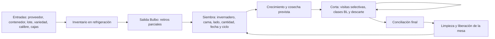

# Flores Volcán: diagnóstico de trazabilidad entre siembra y cosecha

> Este diagnóstico conserva el estado previo a la implementación. Las correcciones y el contrato de la versión 0.7.0 están en [FLORESVOLCAN_0.7.md](../FLORESVOLCAN_0.7.md).

Fecha: 4 de noviembre de 2026. Alcance: ambos Excel del cliente y el código actual del módulo, incluidos los cambios locales de la versión 0.6.0 que aún no están en Git. No se modificaron los instrumentos originales ni la lógica del producto.

## Dictamen

**Los instrumentos mezclan problemas de identificación, cálculos editados y comparación de cantidades a distinta granularidad. El módulo tiene una base útil para corregirlos, pero todavía permite cerrar ciclos sin conciliar y vuelve a producir algunas ambigüedades al exportar.**

La unidad que debe gobernar la conciliación es el **segmento de siembra identificable dentro de un ciclo de una mesa**, con origen de inventario, variedad, fecha, lado o sección y cantidad. La cosecha son muchos eventos que consumen el saldo de ese segmento. Una mesa y una variedad, por sí solas, no identifican una siembra.

El objetivo operativo es explicar qué ocurrió con todo el material y dejar evidencia del cierre y de la limpieza. Una igualdad forzada entre bulbos y tallos vendibles ocultaría pérdidas y podría ser incorrecta para determinados materiales. El cliente todavía debe confirmar las unidades de BL y el rendimiento por bulbo, particularmente las referencias DN. El código actual interpreta BL como conteos de tallos por clase; esa implementación no demuestra que sea la convención del cliente.

## 1. Evidencia y límites del análisis

Se leyeron directamente las celdas, fórmulas, tablas y validaciones del contenido XML de:

- `/home/reymond-e/1_NuevoKaffeTal/Clientes/FloresVolcan/Lirio.xlsx`
- `/home/reymond-e/1_NuevoKaffeTal/Clientes/FloresVolcan/Lirio (2).xlsx`

No se ejecutaron instrucciones de los documentos. Las cifras corresponden a valores guardados en los XLSX: no se abrió Excel para recalcular fórmulas ni se actualizaron vínculos externos. Los textos dentro de columnas numéricas se excluyen de las sumas numéricas y se señalan como incidencias; no son ceros confirmados. Los SHA-256 están en `resumen.json`.

La comparación del módulo se hizo sobre los modelos, esquemas, rutas, migraciones, exportador, formularios de papel, permisos y páginas de Vue. No se consultó la base operativa ni se asumió que las modificaciones locales estén desplegadas. Por ello, se identifican fallas de los instrumentos y del código, pero no se atribuye una pérdida física concreta ni se certifican saldos de producción.

### Dos copias del mismo instrumento

| Hoja | Lirio.xlsx: filas de datos | Lirio (2).xlsx: filas de datos |
|---|---:|---:|
| Entradas | 653 | 653 |
| Salida Bulbo | 1.239 | 1.289 |
| Siembra | 3.603 | 3.603 |
| Corta | 18.637 | 18.637 |

La copia `(2)` tiene 50 salidas adicionales, equivalentes a 228.050 bulbos. Además, cambia `Entradas!B623` de «Baeu Soleil» a «Beau Soleil» y su código asociado; cambia `Siembra!E3592` de cama 8 a cama 18 y su llave; y corrige `Siembra!N3601` de `2646` a `26-46`. Corta y COMANDOS tienen los mismos valores en ambos archivos.

No deben concatenarse ambos libros como dos fuentes de movimientos: se duplicaría casi toda la operación. La copia `(2)` se usa como base del CSV de conciliación por tener esas ampliaciones, sin presumir que sea la versión oficial. Las 655 diferencias de celdas están en `diferencias_entre_archivos.csv`.

## 2. Flujo reconstruido desde los Excel



**Entradas.** Cada fila combina variedad, calibre, contenedor y lote. `Total Bulbos` se obtiene de cajas × cantidad por caja. El código `COD` concatena esos cuatro datos; no es un identificador inmutable de recepción. Hay tres códigos de entrada repetidos, que pueden representar recepciones distintas o duplicación y requieren verificación.

**Salida Bulbo.** Registra retiros parciales de material y usa `BUSCARV` contra Entradas para recuperar común, proveedor, cajas de entrada y unidades por caja. La columna `Stock` busca las cajas originales de la entrada: no calcula el remanente después de todas las salidas. No puede tomarse como existencia disponible.

**Siembra.** Cada fila es una colocación de material en una cama, con lado opcional, variedad, cantidad, ciclo, semanas, fecha, calibre, densidad y sembrador. `M2` se calcula como cantidad/densidad. No hay un vínculo transaccional inequívoco con una salida particular. Se pierde parte del contexto comercial, como el contenedor.

**Corta.** Cada fila es una visita parcial. Su llave reconstruye la referencia a Siembra; `BUSCARV` recupera variedad, proveedor, color, cantidad sembrada y semana prevista. Las clases BL y el descarte se registran por visita. Las columnas de siembra son contexto repetido, mientras que los conteos de corta sí son movimientos acumulables.

**Fin de ciclo.** Los instrumentos no contienen un cierre explícito con cantidades pendientes, verificación de mesa vacía, responsable de limpieza y autorización para la nueva ocupación. La descripción del usuario aporta esa etapa necesaria que las hojas no formalizan.

## 3. Hallazgos demostrables en los Excel

### 3.1. La llave de siembra no identifica un segmento

Las fórmulas son:

```text
Siembra.KEY = INVERNADERO + LOTE + SEMANA_SIEMBRA + CAMA
Corta.KEY   = INV.        + LOTE + SEMANA_SIEMBRA + CAMA
```

No incluyen lado, identificador de segmento, contenedor, proveedor ni variedad. Tampoco tienen separadores. Agregar separadores o lado reduciría colisiones, pero no reemplazaría un ID: hay varias siembras legítimas en el mismo lado y semana.

- Las 3.603 siembras producen 3.512 llaves distintas.
- **91 llaves corresponden a más de una siembra.**
- En 74 de esas llaves hay lados distintos.
- **808 eventos de corta apuntan a llaves ambiguas.**
- Dos llaves mezclan variedades: `6V436947C25-445`, en filas 1162 y 1163, contiene YERSEKE y DYNAMIX; `7V433997C25-4431`, en filas 1166 y 1179, contiene NASHVILLE y HINAULT. Esas dos llaves no tienen cortas en este extracto, pero prueban que la llave no garantiza la identidad de variedad.

Ejemplo directo: `Siembra!192` registra 109 bulbos en lado B y `Siembra!195` registra 400 en lado A bajo la llave `3C1242425-4639`. La corta de las filas 306, 309, 352 y 356 recupera 109 como cantidad sembrada, porque la búsqueda devuelve la primera coincidencia. No puede saberse desde esa llave cuál lado se cortó.

Considerando la búsqueda sin distinguir mayúsculas, todas las llaves de Corta encuentran al menos una siembra. **Encontrar una coincidencia no significa encontrar la siembra correcta.**

### 3.2. Sumar la cantidad sembrada de Corta infla el denominador

La cantidad real registrada en Siembra suma **4.995.191 bulbos**. La columna `Corta.CANTIDAD`, repetida por visita y recuperada desde la primera coincidencia, suma **28.358.759**. No son dos mediciones independientes de siembra ni se deben comparar por suma directa.

Tampoco es suficiente sumar una sola cantidad por KEY: con 91 llaves ambiguas se perderían segmentos legítimos. Debe agregarse Siembra por su ID y Corta por el ID de siembra al que pertenece.

El exportador actual conserva este riesgo: repite la suma sembrada del lote productivo en cada fila de Corta y vuelve a generar la llave concatenada sin lado ni ID.

### 3.3. Existen excesos acumulados que requieren investigación

Agrupando primero todas las siembras de cada llave, y sumando después los totales de corta guardados:

| Resultado diagnóstico, suponiendo factor 1 tallo/bulbo | Llaves |
|---|---:|
| Corta acumulada mayor que siembra | **831** |
| Corta acumulada menor que siembra, con alguna corta | 1.652 |
| Cantidades iguales | 8 |
| Sin cortas registradas | 1.021 |

El exceso bruto de las 831 llaves suma 190.193 unidades bajo ese supuesto. No se compensó con faltantes de otras llaves. **No constituye una pérdida o fraude demostrado:** falta confirmar el factor biológico, resolver asociaciones y revisar conteos. Las 1.021 llaves sin corta tampoco demuestran faltantes: los períodos y estados de cultivo difieren.

| Llave | Filas de Siembra | Sembrado | Corta total guardada | Exceso bajo factor 1 |
|---|---|---:|---:|---:|
| `6CL6845726-0537` | 1056 y 1070 | 5.072 | 11.680 | 6.608 |
| `8VL7514926-1413` | 2014 | 2.000 | 7.305 | 5.305 |
| `7V184536S26-0439` | 950 | 2.440 | 5.776 | 3.336 |

Son casos prioritarios para recuperar las bitácoras originales. El CSV enumera todas las filas de corta relacionadas con cada llave, incluso donde hay varios segmentos y no es posible asignarlas automáticamente.

### 3.4. Hay cálculos sustituidos por valores y conteos textuales

- **7 salidas** no cumplen cajas × unidades por caja = bulbos. Ejemplo: `Salida Bulbo!I7=3`, `L7=400`, `M7=800`; el producto sería 1.200. No puede elegirse cuál cifra corregir sin evidencia.
- **29 filas de Corta** no cumplen `1 BL + 2 BL + 3–5 BL = TOTAL VENTA`. Ejemplo: fila 922 tiene 3 en 2 BL y 261 en 3–5 BL, pero TOTAL VENTA es 261, sin fórmula en esa celda.
- **5 filas de Corta** no cumplen venta + descarte = TOTAL. `T8970` contiene `SA`; `T10455` y `T10676` contienen espacios; `T11073` contiene texto `0` pese a una venta de 148; `T15679` contiene `/9`.
- `Corta!Q7894` contiene `19+`. No se interpreta automáticamente como 19.
- Las filas 10265 y 10272 de Corta tienen todos sus valores idénticos. Es un posible evento duplicado, que debe contrastarse con el original; dos visitas pueden coincidir legítimamente.

Totales numéricos guardados: venta 3.271.534; descarte 92.234; TOTAL 3.363.370. Venta + descarte da 3.363.768: hay una diferencia interna de 398. Sumando directamente las clases numéricas más descarte se obtienen 3.361.903; esta segunda cifra también queda incompleta si existen conteos textuales sin interpretar. **No hay un total histórico único que pueda aceptarse sin revisión.**

Los 831 excesos usan la columna TOTAL guardada. Si se usan componentes numéricos, se señalan 830 llaves: esto muestra que corregir aritmética cambia el diagnóstico, pero no resuelve el problema de trazabilidad.

### 3.5. Fecha, semana y llave pueden contradecirse

Hay 1.189 fechas de Siembra y 47 de Corta que difieren de la semana ISO escrita. Debe verificarse qué calendario semanal usa el cliente antes de clasificarlas todas como errores; el backend utiliza ISO.

Existen contradicciones mayores que una convención semanal: `Siembra!M2` dice `17/11/2026` mientras `L2` dice `25-45`; la fila 1010 tiene `19/02/2019` y la 1922 `27/03/2033`. El rango de fechas de Corta es del 2 de febrero al 28 de agosto de 2026.

En `Corta!A10604`, la llave contiene lote `191802S`, pero `B10604` contiene `538388`. Las búsquedas siguen la llave guardada, no necesariamente el lote visible. Además, 17 celdas recuperadas difieren del valor actualmente presente en la primera siembra coincidente; en estos casos se trata de semanas previstas. Pueden ser valores manuales o cálculos guardados desactualizados; no se recalcularon los libros para decidirlo.

### 3.6. El lote de proveedor tampoco basta para rastrear el origen

En Entradas, 139 números de lote se usan con más de una combinación de variedad, calibre, contenedor o proveedor, normalizando mayúsculas y espacios. Ejemplo: `429437` aparece para NASHVILLE 13/14 en contenedores 12, 13 y 14. No debe reconstruirse el origen de una siembra buscando únicamente el número de lote.

## 4. Comparación con la funcionalidad actual

| Etapa o necesidad | Implementación observada | Evaluación |
|---|---|---|
| Comprar una variedad a varios proveedores | OC por proveedor; varias recepciones y lotes; requisición con varias líneas | Base disponible. Falta una demanda común si se desea planificar abastecimiento agregado. |
| Recibir cajas y contar bulbos | Unidades comerciales/físicas separadas; conversión validada; snapshots | Disponible; importante conservarlo. |
| Refrigeración | Lote con `storage_status='refrigerated'` | Identificación básica. No se observan cámara/posición, temperatura o cadena de frío. |
| Reservar y retirar parcialmente | Reserva al aprobar requisición; entregas parciales; movimientos | Disponible. Material entregado y material sembrado están separados. |
| Bitácora de siembra | `PlantingRecord`, requisición, lote origen, cama, lado, cantidad, densidad, ciclo, operador y cuadrilla | Disponible. Cada registro ya tiene ID. |
| Varios orígenes en una cama | Varios lotes y segmentos en el mismo espacio | Disponible en datos; identificación física de segmentos insuficiente en el flujo. |
| Cosecha prevista | Semana calculada y calendario con fecha estimada | Disponible, pero agrupación por lote puede mezclar fechas/ciclos. |
| Corta selectiva repetida | OT aprobada, múltiples `HarvestRecord`, segmento obligatorio si hay varios | Disponible; mejora sustancial respecto al BUSCARV. |
| No exceder lo sembrado | Límite por segmento × factor; suma acumulada; locks de OT/lote | Disponible para registros vinculados; excepción sin techo y riesgo histórico. |
| Evitar reenvío accidental | `client_token` único y fotos consumidas una vez | Parcial. Token opcional, sin comparación del contenido; fotos nuevas pueden repetir un original. |
| Conciliar y cerrar | Endpoint de cierre técnico con métricas y comentario | Insuficiente: permite diferencias sin resolver. No se encontró botón que ejecute el cierre. |
| Limpiar y reutilizar mesa | Capacidad ocupada calculada con lotes abiertos | Falta un ciclo físico de mesa, evidencia de limpieza y liberación expresa. |
| Exportar para uso diario | Hojas con encabezados familiares | Reproduce llaves ambiguas y cantidades de siembra repetidas; faltan IDs de enlace. |

## 5. Brechas concretas del código y su impacto

### A. Cierre técnico permite finalizar sin reconciliar — prioridad inmediata

`router.py:1366`, `technical_close`, solo exige que no haya OT de cosecha pendientes. Guarda `difference` y el comentario, pero no exige que el remanente esté clasificado, que haya existido cosecha ni que la mesa se haya limpiado.

Se ejecutó esa función real, extraída del AST, con una sesión simulada: **100 sembrados, 0 cosechados y ninguna OT abierta terminan con lote cerrado y diferencia 100**. Es una verificación aislada de la regla, no una prueba de integración.

Al cerrar, la consulta de ocupación deja de contar el área del lote (`router.py:1197`). Por tanto, el sistema puede considerar disponible esa área sin confirmar que las plantas restantes se retiraron. Si hay otros lotes abiertos en la cama, sus áreas sí siguen contando: cerrar un lote no vacía necesariamente toda la mesa.

Además, la pantalla de Cosechas indica que al completar una OT queda habilitado el cierre, pero el enlace lleva al detalle de producción, donde no se encontró una acción que llame a `/technical-close`. Completar OT y cerrar ciclo son operaciones diferentes.

### B. Pantallas de producción piden campos distintos a los de la API

`_batch_metrics` devuelve `planted`, `sale`, `discarded`, `harvested`. Tanto `pages/produccion/[id].vue` como `pages/campo/orden/[id].vue` muestran `total_planted`, `total_sale`, `total_discarded`. Los endpoints de detalle incorporan `_batch_metrics` sin esas traducciones (`router.py:887` y `:906`).

Resultado esperable: totales vacíos en esas vistas aunque existan registros. Es una incompatibilidad concreta del contrato UI/API, separada de las inconsistencias agrícolas. Debe corregirse y verificarse visualmente antes de interpretar lo mostrado al cliente.

### C. El factor tallos/bulbo se aplica al límite pero no a las métricas

`register_harvest`, `router.py:1288`, usa cantidad sembrada × `expected_stems_per_bulb`. En cambio, `_batch_metrics`, el cierre y la alerta gerencial comparan salida directamente con bulbos.

Comprobación aislada de la función real: 100 bulbos, factor 2, salida 150 producen diferencia -50 y rendimiento 150 %. El saldo contra la expectativa técnica sería 50 tallos. La razón tallos/bulbo de 1,5 puede ser un indicador válido si se etiqueta así, pero no es cumplimiento del potencial ni prueba de exceso.

La excepción `allow_overage` solo requiere un motivo y aprobación; no fija una cantidad máxima adicional. Con ella, el límite del segmento queda sin techo cuantitativo. Debe sustituirse por un cupo adicional explícito y auditable, si el negocio necesita excepciones.

### D. La selección explícita de un lote productivo no valida toda su identidad

En `register_planting`, `router.py:1205`, cuando llega `production_batch_id`, se comprueban lote de inventario y cama, pero no se exige misma orden, lado, semana ni ciclo. Una petición puede asociar un segmento a un lote abierto de otra orden o período si coincide origen/cama. La búsqueda automática sí incluye orden, lado y semana, pero no ciclo.

La interfaz actual no envía ese ID, por lo que el caso explícito es un riesgo de la API y de integraciones futuras. También debe rechazarse un ID explícito inexistente, en vez de seleccionar otro lote. Una línea de requisición explícita inexistente tiene una sustitución automática semejante por el primer material elegible (`router.py:1156`), potencialmente equivocado.

### E. Fechas y madurez pierden precisión durante la digitalización

La hoja PDF pide fecha, variedad y ubicación, pero el esquema OCR y la lista de campos que copia Vue no recuperan la fecha ni enlazan automáticamente el material o segmento escrito. El formulario móvil tampoco ofrece fecha de trabajo. Aunque la API admite `planted_at` y `harvested_at`, desde esa pantalla se usa la fecha de digitalización.

Una hoja del viernes registrada el lunes cambia de semana. Densidad y ciclo se pueden cambiar desde Campo sin una autorización técnica separada. La API tampoco exige que la fecha de corta sea posterior a la siembra ni valida la fecha declarada frente a la liberación: compara el día actual con la fecha planificada de OT.

`_harvest_eta`, `router.py:1763`, usa la primera siembra del lote + el ciclo de la cabecera. Si dos registros del mismo lote tienen fechas o ciclos distintos, puede liberar el lote por el segmento más temprano. Debe calcularse madurez por segmento y registrar cualquier adelanto aprobado.

### F. Las migraciones no demuestran preservación de la conciliación histórica

`lifecycle.py:66` agrega `planting_record_id`, clases y `total_output` a tablas antiguas, pero no se encontró una migración que enlace cada cosecha histórica con su siembra ni reconstruya el total de esas filas. La suma usada para limitar cosecha filtra por `planting_record_id`: los registros que permanezcan sin enlace no consumen el cupo del segmento.

La ruta de agregar columnas tampoco crea por sí misma las restricciones únicas de `client_token` declaradas en los modelos para tablas antiguas. Se requiere inspeccionar el esquema real antes de dar esa protección por existente en una actualización.

Es un riesgo condicionado a tener datos/versiones anteriores, no una afirmación sobre la base actual. El test disponible instala sobre el esquema de pruebas y verifica idempotencia, pero no cubre una actualización con siembras y cosechas históricas.

### G. Exportar conserva el problema de identidad del instrumento

`legacy_excel.py:134` y `:156` reconstruyen KEY sin lado ni identificadores. Corta obtiene datos y cantidad a nivel de lote productivo (`:151`), aunque el evento ya tiene `planting_record_id`; no expone el enlace al segmento. Se pierde la mejora de trazabilidad al salir a Excel.

Debe mantenerse el formato familiar si ayuda al usuario, agregando IDs estables y una hoja de conciliación con una fila por segmento. La cantidad sembrada en el detalle de cortas debe identificarse como contexto no sumable.

### H. Quedan riesgos de reenvío, concurrencia y movimientos sin resolución

- Un token repetido del mismo usuario devuelve el registro anterior sin comprobar que el contenido sea idéntico. Si se cambia un formulario después de una respuesta incierta, puede mostrarse éxito para el contenido anterior. Debe exigirse token, asociarlo a una huella del contenido y responder conflicto si cambia.
- La foto se puede contabilizar una sola vez por `PaperCapture`, pero subirla de nuevo crea otra captura; el SHA se guarda sin impedir duplicación. Conviene un folio físico por evento. La huella de imagen es apoyo, porque otra fotografía del mismo papel puede tener otro hash.
- El control de capacidad suma ocupación sin bloquear la cama. Dos siembras simultáneas desde distintos lotes/líneas pueden superar juntas la capacidad. Los locks de inventario no serializan ese recurso compartido. La recepción también comprueba el acumulado de la OC sin bloquear la línea de compra; requiere prueba concurrente en PostgreSQL.
- No se encontraron devoluciones de material desde campo, liberación de reservas ni baja específica del material entregado sin sembrar. Esos saldos necesitan destino trazable antes de cerrar la orden.
- Hay validaciones de cantidades no negativas en los esquemas, pero no restricciones de base de datos equivalentes para toda la contabilidad. Deben definirse invariantes y verificarse en las rutas de escritura y en la base.

## 6. Modelo de control propuesto

### Separar ubicación, ciclo, origen y evento

```text
Mesa permanente
  └─ Ciclo de ocupación de mesa
      ├─ Segmento 1: lado/sección, variedad, fecha, cantidad, origen proveedor A
      │   ├─ Corta parcial 1
      │   ├─ Corta parcial 2
      │   └─ Descarte / merma documentada
      └─ Segmento 2: lado/sección, variedad, fecha, cantidad, origen proveedor B
          └─ Sus propios eventos y saldo
```

Un ciclo puede contener varios orígenes, variedades o fechas si así trabaja el cliente. Cada una conserva sus segmentos y saldos. No se deben fusionar cantidades porque coincidan variedad y mesa. Si una corta realmente mezcla segmentos y no se contó por separado, debe guardarse como un evento con líneas de asignación explícitas cuya suma coincida, o quedar pendiente de revisión; nunca asignarse silenciosamente al primero o prorratearse como hecho observado.

Puede evolucionarse la estructura actual: mantener `InventoryLot`, `PlantingRecord` y `HarvestRecord`, y añadir la ocupación/ciclo físico de la mesa, el estado del segmento y la liberación por limpieza. Evitar una segunda contabilidad desconectada de las tablas existentes.

### Dos conciliaciones con unidades explícitas

**Material de siembra, por lote de inventario:**

```text
Recibido = disponible + reservado + entregado sin sembrar + consumido en siembra + bajas
Entregado por requisición = sembrado + devuelto + bajas en campo + pendiente de sembrar
```

Las devoluciones y bajas deben cambiar estados y saldos una sola vez; devolver algo a disponible implica sacarlo de entregado. Los movimientos son la evidencia y los acumulados deben poder recalcularse desde ellos.

**Producción, por segmento:**

```text
Salida del evento en tallos = clase 1 BL + clase 2 BL + clase 3–5 BL + descarte en tallos
Potencial técnico = bulbos sembrados × factor aprobado para ese segmento
Saldo técnico = potencial técnico + ajustes aprobados − salidas acumuladas
```

Si el descarte se cuenta en plantas o bulbos que nunca produjeron tallos, debe registrarse en esa unidad, con su conversión explícita al potencial; no sumarlo directamente a tallos. El factor es una expectativa técnica, no prueba de existencia física ni de pérdida. Al final, la diferencia frente a la expectativa se clasifica con el técnico y la observación de campo, preservando su significado.

Para material confirmado de un tallo por bulbo, la conciliación física puede simplificarse a sembrados = cortados + descartados + pérdidas identificadas + plantas aún presentes. Esa simplificación debe aprobarse para el cultivo/material correspondiente.

### Estado y cierre físico

```text
Mesa disponible → siembra → crecimiento → cosecha parcial
→ cosecha terminada → conciliación revisada → pendiente de limpieza
→ limpieza confirmada → mesa disponible para el siguiente ciclo
```

Completar una OT solo termina esa tarea. Finalizar un segmento exige resolver sus cantidades. Liberar toda la mesa exige finalizar todos sus segmentos y confirmar limpieza, con fecha y responsable. Si se permiten liberaciones parciales, deben identificarse las secciones y su área, sin liberar automáticamente el resto.

La pantalla diaria debe mostrar ubicación física completa, lado/sección, variedad, proveedor/lote origen, fecha real, cantidad sembrada, acumulado vendido, descarte, ajustes y saldo del segmento. El QR debería identificar la mesa/ciclo y permitir elegir el segmento físico correcto. El QR actual abre una orden y luego envía al listado general de Campo; no fija el segmento de corta.

## 7. Correcciones por orden de implementación

| Prioridad | Entregable concreto | Criterio de aceptación |
|---|---|---|
| P0 | Reparar campos UI/API y resumen por segmento | Producción, Campo, resumen y exportación muestran las mismas cifras para el mismo ID. |
| P0 | Identidad estricta de lote/segmento y unidades | No se aceptan referencias de otra orden, lado, ciclo o material; no se sustituye un ID explícito inválido. |
| P0 | Conciliación y cierre con cantidades resueltas | No se cierra con remanentes sin clasificar; completar OT no libera área; limpieza necesaria para reutilizar la mesa. |
| P0 | Revisar datos existentes antes de activar límites | Cortas sin segmento y migraciones incompletas quedan identificadas; no se ignoran consumos históricos ni se inventan asignaciones. |
| P1 | Fechas reales y madurez por segmento | Papel del viernes digitalizado lunes conserva fecha y semana del viernes; una corta anterior a la siembra se rechaza. |
| P1 | Idempotencia y concurrencia | Reenvío idéntico produce un solo movimiento; contenido distinto con el mismo token da conflicto; dos dispositivos no exceden saldos/capacidad. |
| P1 | Devoluciones, bajas y reversos auditados | Todo material entregado tiene destino; una corrección revierte explícitamente el original y conserva evidencia. |
| P1 | Exportación con IDs y conciliación | Una fila por segmento en conciliación; cada corta enlaza al segmento; sumar visitas no multiplica lo sembrado. |
| P2 | Planificación de demanda y refrigeración detallada | Una demanda puede abastecerse desde varios proveedores; cámaras y condiciones se incorporan si el cliente las requiere. |

No haría del OCR el primer mecanismo de control. La lectura automática facilita la captura, pero no resuelve la identidad física, las unidades ni el cierre. Debe seguir produciendo un borrador confirmado, con folio y fecha real.

## 8. Casos de aceptación imprescindibles para el blindaje

1. Misma variedad en una mesa desde dos proveedores: dos segmentos independientes; ninguna corta consume el saldo del otro.
2. Mismo origen en lados A y B, misma semana: IDs distintos y selección física clara.
3. Dos siembras en el mismo lado: se distinguen aunque coincidan semana y variedad.
4. Siembra confirmada de 1.000 unidades, factor 1: 300 vendidos, luego 400 vendidos y 20 descartados dejan 280; intentar registrar otras 281 unidades se rechaza sin excepción cuantificada.
5. La OT termina con 280 pendientes: el ciclo no se libera hasta clasificar la diferencia y confirmar retiro/limpieza. Las pérdidas se muestran separadas de venta y descarte.
6. Factor 2 aprobado: 100 bulbos y 150 tallos muestran 50 de diferencia contra potencial; la razón tallos/bulbo se etiqueta por separado.
7. Un ciclo cerrado o una mesa pendiente de limpieza impiden nueva ocupación incompatible. Otros segmentos activos conservan su área.
8. Dos trabajadores cosechan simultáneamente el mismo saldo: solo se aceptan cantidades que quepan de forma conjunta.
9. Reintento por pérdida de conexión: un único movimiento. Cambio de contenido con el mismo token: conflicto y recuperación del registro previo.
10. Papel con fecha anterior: se conserva fecha de trabajo y fecha de captura. La foto repetida queda señalada sin doble contabilización inadvertida.
11. Actualización desde datos antiguos: totales y cosechas previas siguen consumiendo saldo; los enlaces ambiguos bloquean la conciliación hasta revisión.
12. Exportación de un segmento con cinco cortas: el resumen cuenta una sola siembra y cinco movimientos, preservando sus IDs.

## 9. Tratamiento del histórico

Conservar los dos originales y elegir con el cliente una copia oficial. Registrar cada fila de origen y su archivo antes de transformar. Corregir nombres mediante un catálogo de equivalencias revisable, sin unir automáticamente lotes comerciales distintos.

Importar primero a un área de revisión. Resolver las 91 llaves ambiguas, los conteos textuales, la posible duplicación y las contradicciones de fecha/lote contra las bitácoras originales. Una corta con varias siembras candidatas debe quedar «pendiente de asignación» con su cantidad íntegra, sin repartirse automáticamente.

Emitir un balance por lote de origen, segmento, mesa/ciclo y variedad, separando ciclos abiertos, cerrados y registros pendientes. No compensar excedentes de una cama con faltantes de otra. No usar la diferencia global entre 6.532.000 recibidos, 6.227.100 salidos y 4.995.191 sembrados como faltante: no se han conciliado fechas de corte, inventario inicial, devoluciones y movimientos de cada origen.

## 10. Archivos y reproducción

- `incidencias_excel.csv`: ambos libros, hoja, fila, celda, valor observado y contraste. Las anomalías coincidentes en las dos copias aparecen dos veces con su archivo; no son dos incidentes operativos distintos.
- `conciliacion_por_llave.csv`: 3.512 llaves de `(2)`, filas de siembra/corta, cantidades guardadas, suma de componentes numéricos, indicador de ambigüedad y diagnóstico con factor 1. La lista de filas permite rastrear los casos al original; no atribuye las cortas a segmentos ambiguos.
- `diferencias_entre_archivos.csv`: todas las celdas con valores distintos.
- `resumen.json`: cifras, metodología y huellas de los originales.
- `auditar_excel.py`: auditoría reproducible de solo lectura con la biblioteca estándar de Python.
- `verificar_reglas.py`: ejecuta dos funciones reales del router aisladas de importaciones, con consultas simuladas; demuestra cierre sin cosecha y métricas inconsistentes con el factor. No reemplaza pruebas de API o concurrencia.

Desde la raíz RuralIA:

```bash
python3 backend/backend/docs/analisis_floresvolcan_2026-11-04/auditar_excel.py \
  '/home/reymond-e/1_NuevoKaffeTal/Clientes/FloresVolcan' \
  /tmp/fv-auditoria-reproducida

python3 backend/backend/docs/analisis_floresvolcan_2026-11-04/verificar_reglas.py
```

La revisión encontró que `test_floresvolcan_field_v06.py` cubre permisos declarados, instalación idempotente, PDF, validación de imagen y esquemas. No prueba las rutas transaccionales de siembra/cosecha, la conciliación, la migración con histórico ni la concurrencia. No se ejecutó esa suite en este análisis: el Python disponible no tiene instaladas sus dependencias. Sí se ejecutaron la auditoría completa de ambos archivos y las dos verificaciones aisladas descritas.

Las decisiones funcionales pendientes de validar con el cliente son: unidad exacta de BL y descarte; factores por material y tratamiento de DN; calendario semanal; forma física de distinguir segmentos; y quién acredita remanentes, ajustes y limpieza. Ninguna impide corregir los errores de identidad, contrato UI/API y sumas demostrados aquí.


[Mejoras de rendimiento · 5 de noviembre de 2026](rendimiento_2026-11-05.md)
